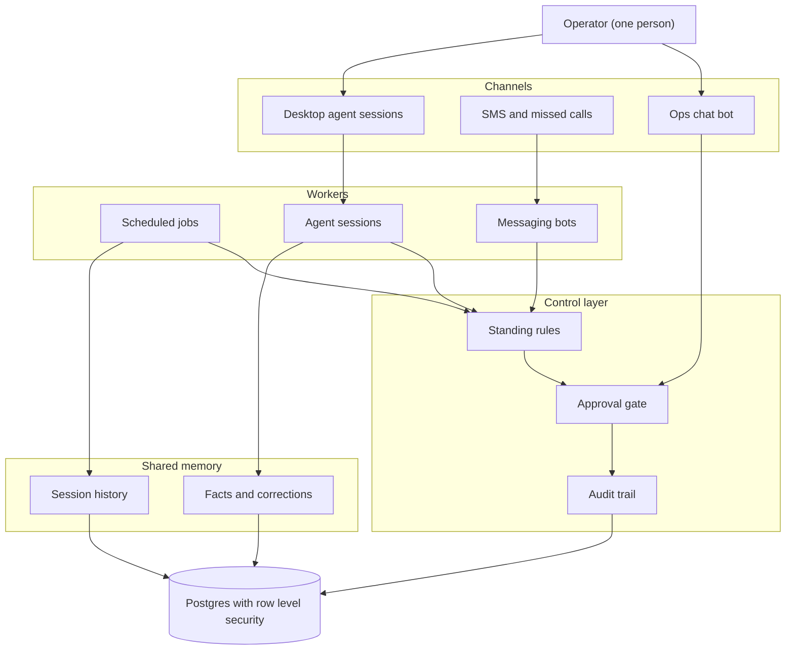

# operator-stack

One operator, two small service companies, and a set of AI agents that do the
routine work without losing context or acting without permission. This repo is
the map: how the pieces fit, and where each piece lives.

## The problem

A small operator cannot staff a back office, and AI agents on their own forget
everything between sessions and will happily act without asking. Running real
companies on them needs shared memory, written rules, an approval step, and a
database that keeps the two companies apart.

## What this repo does

- Explains the operating model in six short pages under [docs/](docs/architecture.md).
- Indexes the 41 companion repos, each a small working example of one pattern.
- Ships [scripts/validate.py](scripts/validate.py), a standard library checker
  for every internal link, heading anchor and mermaid block in the repo, plus
  the repo index table below and every repo name cited in the docs. The tests
  and CI run it.

## Architecture



Read the pages in this order:

| Page | Question it answers |
|------|---------------------|
| [Architecture](docs/architecture.md) | What are the layers and how does a request move through them? |
| [Shared memory](docs/shared-memory.md) | How does a new session know what the last one learned? |
| [Rules and approvals](docs/rules-and-approvals.md) | What may an agent do alone, and what waits for a yes? |
| [Scheduled jobs](docs/scheduled-jobs.md) | What runs with nobody watching, and how do failures surface? |
| [Messaging bots](docs/messaging-bots.md) | How do inbound texts and chat commands become safe actions? |
| [Row level security](docs/row-level-security.md) | How do two companies share one database without leaking? |

## Run it

```bash
python scripts/validate.py
```

That is the whole install. Python 3.10 or newer, no packages, no network, no
keys. It prints one line per problem and exits non-zero if it finds any.

When the companion folders sit next to this one, add `--siblings ..` to also
check that the index and the folders on disk are the same 41 names. That check
reads folder names only.

## Run the tests

```bash
python -m unittest discover -s tests -v
```

The tests exercise each check against small bad inputs, then run the validator
on this repo itself, so a broken link or diagram in the docs fails CI.

## Demo

```bash
python demo/run_demo.py
```

The demo validates this repo, then builds a throwaway copy of a tiny docs tree
with seven planted faults (dead link, dead anchor, two broken diagrams, a
repo missing from the table, a cited repo that does not exist, an orphan page)
and shows the validator catching each one. The captured output is in
[demo/output.txt](demo/output.txt); the script writes the same bytes on every
platform and a test compares the two.

## Repo index

The stack is split into 41 small repos, listed here by folder name. Names are
relative on purpose; links are added at publication. The table is generated
from [data/repos.json](data/repos.json) with
`python scripts/validate.py --write-index`, and the validator fails if the two
drift apart, or if a page cites a backticked repo name that is not in the
index.

<!-- repo-index:start -->
| # | Folder | Area | What it shows |
|---|--------|------|---------------|
| 1 | `agent-memory-supabase` | Memory | Durable facts and session history in Postgres that every agent session reads and writes |
| 2 | `brain-boot-mcp` | Memory | Tool server that hands a new session its boot pack of rules, corrections and due items |
| 3 | `correction-distiller` | Memory | Turns operator corrections into short standing rules so a mistake is made once |
| 4 | `send-gate` | Rules | Checks every outbound message for consent, rate and approval before it leaves |
| 5 | `sms-approval-desk` | Rules | Holds risky actions in a queue until the operator approves or rejects by text |
| 6 | `commit-trailer-guard` | Rules | Rejects commits that lack a required provenance trailer line |
| 7 | `pii-screen` | Rules | Screens text for phone numbers and emails before it reaches an outside model |
| 8 | `claude-code-ops-kit` | Rules | Hooks, settings and checklists that keep coding agent sessions inside the rules |
| 9 | `job-watchdog` | Jobs | Notices scheduled jobs that stopped reporting and raises one alert, not fifty |
| 10 | `stall-board` | Jobs | Lists work that has sat too long without a next step, oldest first |
| 11 | `webhook-reliability-kit` | Jobs | Signature checks, deduplication, retries and a dead letter queue for webhooks |
| 12 | `n8n-workflow-library` | Jobs | Reusable workflow definitions for common small business automations |
| 13 | `ai-receptionist-starter` | Bots | Answers inbound contacts, collects the details and hands off to a person |
| 14 | `missed-call-textback` | Bots | Replies to a missed call by text within a minute, inside quiet hours rules |
| 15 | `speed-to-lead` | Bots | Gets a first response to a new lead in minutes and tracks the follow ups |
| 16 | `topic-per-customer-bot` | Bots | Chat bot that keeps one thread per customer so context never mixes |
| 17 | `review-request-engine` | Bots | Asks for a review after a finished job, once, at a sensible time |
| 18 | `supabase-rls-cookbook` | Database | Row level security policies and tests for a Postgres schema shared by two tenants |
| 19 | `encrypted-supabase-backups` | Database | Scheduled database dumps, encrypted before they leave the machine |
| 20 | `crm-migration-kit` | Database | Maps, cleans and deduplicates contacts when moving between CRMs, with a dry run |
| 21 | `agent-dispatcher` | Agents | Splits a goal into tasks, fans them out to workers and verifies what comes back |
| 22 | `agent-eval-harness` | Agents | Scores agent output against fixed cases so changes can be compared |
| 23 | `cheap-first-router` | Agents | Sends routine work to a small model and judgment calls to a strong one |
| 24 | `prompt-cache-cost-lab` | Agents | Measures what prompt caching saves across different prompt layouts |
| 25 | `codebase-scanner-cli` | Agents | Walks a repository and reports structure, risks and stale spots |
| 26 | `field-service-mcp` | Agents | Tool server that exposes jobs, customers and schedules to an agent, on mock data |
| 27 | `trades-skill-pack` | Agents | Packaged agent skills for common tasks in the home service trades |
| 28 | `same-automation-four-ways` | Agents | One automation built four ways to compare effort, cost and upkeep |
| 29 | `remodel-estimator` | Operations | Builds a line item estimate from a scope description and a price book |
| 30 | `scope-of-work-generator` | Operations | Turns job notes into a clear scope of work with inclusions and exclusions |
| 31 | `change-order-tracker` | Operations | Records changes to an agreed scope with price, approval and running total |
| 32 | `job-costing` | Operations | Compares estimated and actual labor and material cost for each job |
| 33 | `photo-to-punch-list` | Operations | Turns site photos and notes into a punch list, with a mock vision step |
| 34 | `crew-onboarding-intake` | Operations | Collects and checks what a new crew member or subcontractor must provide |
| 35 | `owner-dashboard` | Operations | One page of the numbers an owner checks each morning |
| 36 | `clickup-dry-run` | Operations | Previews task changes as a diff before anything is written to the task tool |
| 37 | `ghl-home-services-blueprint` | Operations | Pipeline, field and automation layout for a home services CRM account |
| 38 | `fastapi-ops-starter` | Operations | Small API service skeleton with health checks, auth stub and tests |
| 39 | `brrr-deal-analyzer` | Operations | Runs the numbers on a buy, rehab, rent, refinance property deal |
| 40 | `reddit-pain-miner` | Operations | Mines forum threads for recurring customer pain points, on canned data |
| 41 | `book-pipeline` | Operations | Moves a long document from outline to draft to edit in tracked stages |
<!-- repo-index:end -->

## Where this pattern runs

Everything described here is drawn from systems that run two small service
companies day to day: one operator, a handful of field crews and office tasks,
and agents doing intake, follow up, scheduling support and record keeping. The
write-up is the design with every real name, number and record removed.

## Limitations

- This is documentation plus a checker. It contains no running agents, bots or
  database; those live in the companion repos.
- The mermaid check is a structural lint (diagram type, direction, balanced
  brackets and blocks, at least one edge or message). It is not the real
  mermaid parser and can pass a diagram that still fails to render.
- Link checking is offline. External URLs are counted, never fetched.
- Anchor slugs follow the common GitHub rules; unusual headings (emoji, raw
  HTML) may slug differently on the site.
- The index rows are plain folder names, not links, until publication. The
  one line summaries are written from this hub's point of view; each companion
  repo's own README is the authority on what it does.
- The default run can only check names against data/repos.json. Checking them
  against real folders needs `--siblings`, which CI does not run because the
  hub is checked out alone there.
- The repo name check treats any backticked kebab-case word with a hyphen as a
  repo name. A page that needs such a word for something else has to write it
  without backticks.
- The operating model suits one operator and a small team. It does not cover
  multi-approver workflows, on-call rotations or compliance regimes.

## License

License: MIT, see the LICENSE file.
