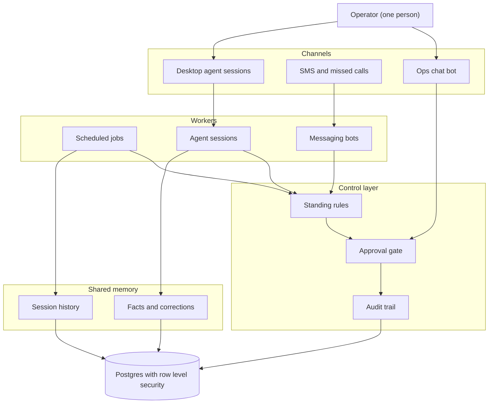

# operator-stack

One operator, two small service companies, and a set of AI agents that do the
routine work without losing context or acting without permission. This repo is
the map: how the pieces fit, and where each piece lives.

## The problem

A small operator cannot staff a back office, and AI agents on their own forget
everything between sessions and will happily act without asking. Running real
companies on them needs shared memory, written rules, an approval step, and a
database that keeps the two companies apart.

## What this repo does

- Explains the operating model in six short pages under [docs/](docs/architecture.md).
- Indexes the 41 companion repos, each a small working example of one pattern.
- Ships [scripts/validate.py](scripts/validate.py), a standard library checker
  for every internal link, heading anchor and mermaid block in the repo, plus
  the repo index table below and every repo name cited in the docs. The tests
  and CI run it.

## Architecture



Read the pages in this order:

| Page | Question it answers |
|------|---------------------|
| [Architecture](docs/architecture.md) | What are the layers and how does a request move through them? |
| [Shared memory](docs/shared-memory.md) | How does a new session know what the last one learned? |
| [Rules and approvals](docs/rules-and-approvals.md) | What may an agent do alone, and what waits for a yes? |
| [Scheduled jobs](docs/scheduled-jobs.md) | What runs with nobody watching, and how do failures surface? |
| [Messaging bots](docs/messaging-bots.md) | How do inbound texts and chat commands become safe actions? |
| [Row level security](docs/row-level-security.md) | How do two companies share one database without leaking? |

## Run it

```bash
python scripts/validate.py
```

That is the whole install. Python 3.10 or newer, no packages, no network, no
keys. It prints one line per problem and exits non-zero if it finds any.

When the companion folders sit next to this one, add `--siblings ..` to also
check that the index and the folders on disk are the same 41 names. That check
reads folder names only.

## Run the tests

```bash
python -m unittest discover -s tests -v
```

The tests exercise each check against small bad inputs, then run the validator
on this repo itself, so a broken link or diagram in the docs fails CI.

## Demo

```bash
python demo/run_demo.py
```

The demo validates this repo, then builds a throwaway copy of a tiny docs tree
with seven planted faults (dead link, dead anchor, two broken diagrams, a
repo missing from the table, a cited repo that does not exist, an orphan page)
and shows the validator catching each one. The captured output is in
[demo/output.txt](demo/output.txt); the script writes the same bytes on every
platform and a test compares the two.

## Repo index

The stack is split into 41 small repos, listed here by name. Each name
links to its public repository. The table is generated
from [data/repos.json](data/repos.json) with
`python scripts/validate.py --write-index`, and the validator fails if the two
drift apart, or if a page cites a backticked repo name that is not in the
index.

<!-- repo-index:start -->
| # | Folder | Area | What it shows |
|---|--------|------|---------------|
| 1 | [`agent-memory-supabase`](https://github.com/midcityhandyman/agent-memory-supabase) | Memory | Layered agent memory on Postgres: hybrid text and vector recall re-ranked by recorded outcomes |
| 2 | [`brain-boot-mcp`](https://github.com/midcityhandyman/brain-boot-mcp) | Memory | MCP server that hands an agent its standing rules, recent corrections and due items at session start |
| 3 | [`correction-distiller`](https://github.com/midcityhandyman/correction-distiller) | Memory | Turns human corrections of an agent into proposed rules that wait in an approval queue |
| 4 | [`send-gate`](https://github.com/midcityhandyman/send-gate) | Rules | Human approval gate for agent outbound messages: rule checks, exact-text approval, send, read-back, audit |
| 5 | [`sms-approval-desk`](https://github.com/midcityhandyman/sms-approval-desk) | Rules | Mini app where staff approve, edit or reject each outbound text before it sends |
| 6 | [`commit-trailer-guard`](https://github.com/midcityhandyman/commit-trailer-guard) | Rules | GitHub Action that fails a pull request when a commit lacks a required trailer |
| 7 | [`pii-screen`](https://github.com/midcityhandyman/pii-screen) | Rules | Screens text for phones, emails, addresses and roster names before it reaches a third-party model |
| 8 | [`claude-code-ops-kit`](https://github.com/midcityhandyman/claude-code-ops-kit) | Rules | Claude Code plugin: definition-of-done Stop hook, scope checklist and a wrap-up skill |
| 9 | [`job-watchdog`](https://github.com/midcityhandyman/job-watchdog) | Jobs | Watchdog for scheduled jobs: alerts on failure and on silence past the expected interval |
| 10 | [`stall-board`](https://github.com/midcityhandyman/stall-board) | Jobs | Work-in-flight board for a fleet of agents: flags idle, blocked and waiting-on-human tasks |
| 11 | [`webhook-reliability-kit`](https://github.com/midcityhandyman/webhook-reliability-kit) | Jobs | Idempotency keys, outbox drain with backoff, dead letters and replay, proven by a chaos test |
| 12 | [`n8n-workflow-library`](https://github.com/midcityhandyman/n8n-workflow-library) | Jobs | Ten production-grade n8n workflows for service businesses, each with error and dead-letter paths |
| 13 | [`ai-receptionist-starter`](https://github.com/midcityhandyman/ai-receptionist-starter) | Bots | Voice AI receptionist for home services: qualify, book, hand off, after-hours rules, call simulator |
| 14 | [`missed-call-textback`](https://github.com/midcityhandyman/missed-call-textback) | Bots | One text back on a missed call, with quiet hours, opt-out and no double texting |
| 15 | [`speed-to-lead`](https://github.com/midcityhandyman/speed-to-lead) | Bots | Lead intake that validates, scores, routes and replies in under 60 seconds, with a metrics page |
| 16 | [`topic-per-customer-bot`](https://github.com/midcityhandyman/topic-per-customer-bot) | Bots | Telegram bot pattern: one forum topic per customer, every event filed there, edits over re-sends |
| 17 | [`review-request-engine`](https://github.com/midcityhandyman/review-request-engine) | Bots | Review asks after job close with timing, suppression rules and a sent or suppressed report |
| 18 | [`supabase-rls-cookbook`](https://github.com/midcityhandyman/supabase-rls-cookbook) | Database | Row level security patterns for Supabase and Postgres with pgTAP tests and a grant audit |
| 19 | [`encrypted-supabase-backups`](https://github.com/midcityhandyman/encrypted-supabase-backups) | Database | Nightly age-encrypted Postgres backups with retention and an automated restore test |
| 20 | [`crm-migration-kit`](https://github.com/midcityhandyman/crm-migration-kit) | Database | CLI for CRM migrations: normalise, dedupe with explainable rules, map fields, validation report |
| 21 | [`agent-dispatcher`](https://github.com/midcityhandyman/agent-dispatcher) | Agents | Lead agent decomposes a goal, workers run with fresh context, an independent verifier refutes or accepts |
| 22 | [`agent-eval-harness`](https://github.com/midcityhandyman/agent-eval-harness) | Agents | Golden-set evals for a customer service agent with an LLM judge and CI regression gate |
| 23 | [`cheap-first-router`](https://github.com/midcityhandyman/cheap-first-router) | Agents | Routes bulk work to a low-cost model, verifies with a strong one, reports cost and escalations |
| 24 | [`prompt-cache-cost-lab`](https://github.com/midcityhandyman/prompt-cache-cost-lab) | Agents | Before and after cost numbers for prompt caching, batching and model choice on one workload |
| 25 | [`codebase-scanner-cli`](https://github.com/midcityhandyman/codebase-scanner-cli) | Agents | CLI that reports a repository's structure, language mix, dead files and risky patterns |
| 26 | [`field-service-mcp`](https://github.com/midcityhandyman/field-service-mcp) | Agents | MCP server exposing a field service system (jobs, customers, visits, quotes) to agents |
| 27 | [`trades-skill-pack`](https://github.com/midcityhandyman/trades-skill-pack) | Agents | Claude skills for residential remodeling: scope of work, material takeoff, change orders |
| 28 | [`same-automation-four-ways`](https://github.com/midcityhandyman/same-automation-four-ways) | Agents | One lead follow-up built in n8n, Make, Zapier and Python, compared on failure handling and upkeep |
| 29 | [`remodel-estimator`](https://github.com/midcityhandyman/remodel-estimator) | Operations | Remodel scope in, material takeoff, labor hours and a priced estimate out, with a web UI |
| 30 | [`scope-of-work-generator`](https://github.com/midcityhandyman/scope-of-work-generator) | Operations | Trade-by-trade scopes of work for bathroom, kitchen and basement remodels from a short intake |
| 31 | [`change-order-tracker`](https://github.com/midcityhandyman/change-order-tracker) | Operations | Change orders from request to signed approval with an immutable audit trail |
| 32 | [`job-costing`](https://github.com/midcityhandyman/job-costing) | Operations | Estimate against actuals by trade, margin drift and below-target job flags |
| 33 | [`photo-to-punch-list`](https://github.com/midcityhandyman/photo-to-punch-list) | Operations | Job site photos to a punch list by room and trade using a vision model |
| 34 | [`crew-onboarding-intake`](https://github.com/midcityhandyman/crew-onboarding-intake) | Operations | Crew and subcontractor onboarding: profile, document checklist by role, retried sync |
| 35 | [`owner-dashboard`](https://github.com/midcityhandyman/owner-dashboard) | Operations | Next.js dashboard of the weekly numbers a service business owner runs the company from |
| 36 | [`clickup-dry-run`](https://github.com/midcityhandyman/clickup-dry-run) | Operations | Simulates task automations against exported data before anything touches the real workspace |
| 37 | [`ghl-home-services-blueprint`](https://github.com/midcityhandyman/ghl-home-services-blueprint) | Operations | Documented CRM blueprint for home services: pipelines, fields, workflows and a validator |
| 38 | [`fastapi-ops-starter`](https://github.com/midcityhandyman/fastapi-ops-starter) | Operations | Slim operations API: auth, multi-source ingestion into one record table, background jobs |
| 39 | [`brrr-deal-analyzer`](https://github.com/midcityhandyman/brrr-deal-analyzer) | Operations | Rental deal analyzer for buy, rehab, rent, refinance: cash flow, returns, DSCR and a score |
| 40 | [`reddit-pain-miner`](https://github.com/midcityhandyman/reddit-pain-miner) | Operations | Pulls threads on a topic and ranks the pain points with short quotes |
| 41 | [`book-pipeline`](https://github.com/midcityhandyman/book-pipeline) | Operations | Markdown manuscript to EPUB and print-ready HTML in one command |
<!-- repo-index:end -->

## Where this pattern runs

Everything described here is drawn from systems that run two small service
companies day to day: one operator, a handful of field crews and office tasks,
and agents doing intake, follow up, scheduling support and record keeping. The
write-up is the design with every real name, number and record removed.

## Limitations

- This is documentation plus a checker. It contains no running agents, bots or
  database; those live in the companion repos.
- The mermaid check is a structural lint (diagram type, direction, balanced
  brackets and blocks, at least one edge or message). It is not the real
  mermaid parser and can pass a diagram that still fails to render.
- Link checking is offline. External URLs are counted, never fetched.
- Anchor slugs follow the common GitHub rules; unusual headings (emoji, raw
  HTML) may slug differently on the site.
- The index rows link to each repository through base_url in data/repos.json. The
  one line summaries are written from this hub's point of view; each companion
  repo's own README is the authority on what it does.
- The default run can only check names against data/repos.json. Checking them
  against real folders needs `--siblings`, which CI does not run because the
  hub is checked out alone there.
- The repo name check treats any backticked kebab-case word with a hyphen as a
  repo name. A page that needs such a word for something else has to write it
  without backticks.
- The operating model suits one operator and a small team. It does not cover
  multi-approver workflows, on-call rotations or compliance regimes.

## License

License: MIT, see the LICENSE file.
