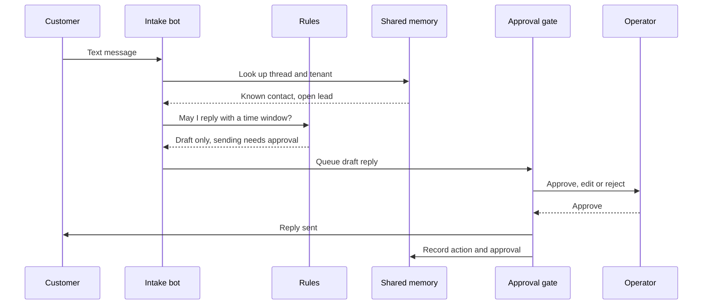

# Architecture

The stack has four layers. Each one exists because of a specific failure that
happens without it.

| Layer | Without it |
|-------|------------|
| Channels | Work arrives in five places and nobody owns the thread |
| Control | An agent sends a message or changes a record nobody approved |
| Shared memory | Every session starts from zero and repeats old mistakes |
| Data | One company's customer shows up in the other company's report |

## Life of one request

A customer texts after hours asking for a quote. Nothing below needs a person
until the approval step.

Three things to notice:

1. The bot asks the rules before it acts, not after. See
   [Rules and approvals](rules-and-approvals.md#tiers).
2. The approval and the action are written to memory together, so the
   [audit trail](rules-and-approvals.md#audit-trail) never has an action
   without a reason.
3. The tenant is resolved first. Every later read and write is scoped by it;
   see [Row level security](row-level-security.md).

## Components and where they live

| Component | Page | Example repos |
|-----------|------|---------------|
| Fact store, boot pack, corrections | [Shared memory](shared-memory.md) | `agent-memory-supabase`, `brain-boot-mcp`, `correction-distiller` |
| Approvals, send gate, provenance check | [Rules and approvals](rules-and-approvals.md) | `sms-approval-desk`, `send-gate`, `commit-trailer-guard` |
| Heartbeats, stalled work, retries | [Scheduled jobs](scheduled-jobs.md) | `job-watchdog`, `stall-board`, `webhook-reliability-kit` |
| Threads, text back, first response | [Messaging bots](messaging-bots.md) | `topic-per-customer-bot`, `missed-call-textback`, `speed-to-lead` |
| Policies, backups, redaction | [Row level security](row-level-security.md) | `supabase-rls-cookbook`, `encrypted-supabase-backups`, `pii-screen` |

## Design choices

- **One database, many small programs.** Agents, bots and jobs are separate
  and replaceable. The database is the only shared state, so it is the only
  place isolation has to be perfect.
- **Rules are data.** A rule is a row with a scope and a date, not a sentence
  buried in a prompt. That makes it loadable, testable and auditable.
- **Cheap models for cheap work.** Lookups and summaries go to a small model,
  judgment and anything a customer reads go to a strong one. Customer details
  are redacted before any text leaves for an outside model.
- **Everything ends labeled.** A task finishes as done with evidence, blocked
  with the first failing check, or open with an owner. Nothing ends as
  "probably fine".

Back to the [README](../README.md).
