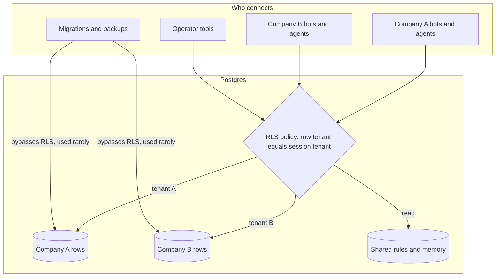

# Row level security

Both companies live in one Postgres database. Row level security (RLS) makes
the database itself refuse a cross-company read, so isolation does not depend
on every agent, bot and job remembering a `where` clause.

## Roles and what they see



## The pattern

Every business table has a `tenant_id`. RLS is enabled and forced, and one
policy compares the row to the tenant on the session:

```sql
alter table leads enable row level security;
alter table leads force row level security;

create policy tenant_isolation on leads
  using (tenant_id = current_setting('app.tenant_id')::uuid)
  with check (tenant_id = current_setting('app.tenant_id')::uuid);
```

`using` filters what can be read; `with check` stops a write that would put a
row in the other tenant. Both are needed. A policy with only `using` lets a
client insert rows it can never see again, into someone else's tenant.

## What is scoped

| Data | Scope |
|------|-------|
| Leads, jobs, estimates, invoices, messages | One tenant |
| Corrections and due items | One tenant |
| Standing rules that apply to both companies | Shared, read only to agents |
| Audit trail | One tenant for reads, append only for everyone |
| Run tables for jobs | Shared, no customer data in them |

## Rules that keep it honest

1. **Default deny.** A table with RLS on and no policy returns nothing. New
   tables start there.
2. **Agents never hold the service key.** The role that bypasses RLS is for
   migrations and backups, run by a person or a reviewed job.
3. **Views and functions are checked too.** A view owned by a privileged role
   can leak past RLS unless it runs with the caller's rights.
4. **Tests prove the negative.** A test connects as tenant A and asserts
   that tenant B's rows are invisible and unwritable, on every table.
   `supabase-rls-cookbook` is the companion repo for this pattern.
   A table missing from the test list fails the build.
5. **Redact before leaving.** Text sent to an outside model has phone numbers
   and emails stripped first. RLS protects the database; it does nothing for a
   prompt.

## Limits

RLS does not stop an agent with the right tenant from doing the wrong thing
inside it. That is the job of the tiers in
[Rules and approvals](rules-and-approvals.md#tiers). It also adds a predicate
to every query, so `tenant_id` belongs in the indexes.

Back to [Architecture](architecture.md) or the [README](../README.md#repo-index).
