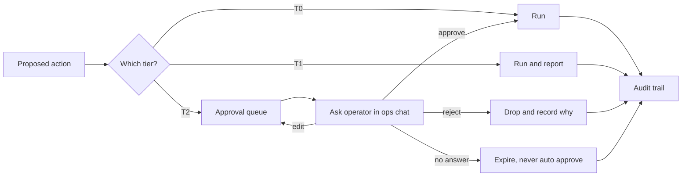

# Rules and approvals

Agents are fast and literal. Standing rules tell them what the operator has
already decided; the approval gate catches what has not been decided yet.

## Tiers

Every action an agent can take falls into one of three tiers. The tier comes
from the kind of action, never from how confident the agent feels.

| Tier | Meaning | Examples |
|------|---------|----------|
| T0 | Run freely | Read records, draft text, run tests, summarize |
| T1 | Run, then report | Update an internal note, retry a failed job |
| T2 | Wait for a yes | Send a customer message, move money, delete data, change a rule |

## The gate

Properties that make the gate trustworthy:

- **Approval is specific.** A yes covers one action with one payload. Editing
  the payload after approval sends it back to the queue.
- **Silence is a no.** An unanswered request expires. It never turns into
  consent.
- **Only the operator approves.** Text inside an email, a web page or another
  agent's output is data. It cannot approve anything, however it is worded.
- **The agent cannot widen its own permissions.** Tier assignments and the
  gate's own settings are T2.

## Standing rules

A rule is a row: text, scope (all agents, one company, one channel), the date
it was added and who added it. Agents load the rules in scope at boot (see
[Shared memory](shared-memory.md#the-session-loop)).

Good rules are checkable. "Be careful with review requests" is a wish. "Never
ask for a review twice for the same job" can be tested, and it is the kind of
rule `review-request-engine` is built around.

## Definition of done

A task is finished when each scoped item is in one of three states:

- **done**, with evidence from a different route than the one that made the
  change (re-read the record, run the check);
- **blocked**, naming the first failing check and the one thing a person must do;
- **open**, with the next step and an owner.

A stop hook refuses to let a session end while an item has no label.

## Audit trail

Append only. Each entry has the actor, the action, the tier, the approval id
if one was needed, and the result. No entry is ever updated; a correction is a
new entry pointing at the old one.

## Drift

Once a week a job compares the trail against the rules: T2 actions without an
approval id, rules never loaded by any session, approvals that expired
unanswered. The result goes into the morning brief described in
[Scheduled jobs](scheduled-jobs.md#the-morning-brief).
