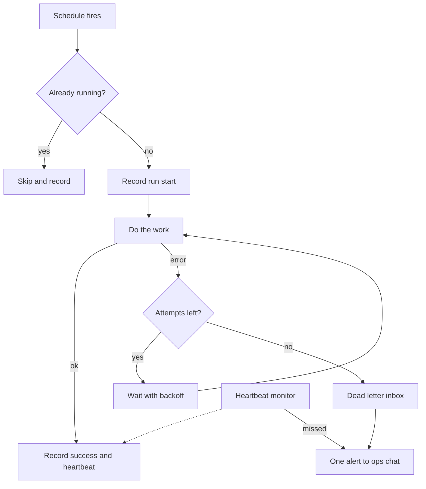

# Scheduled jobs

Jobs are the part of the stack that runs with nobody watching. That makes
their failure mode different: a broken job is silent, so the design goal is to
make silence visible.

## Job lifecycle

## Rules every job follows

1. **Idempotent.** Running twice must not send twice. Each unit of work has a
   key, and the key is checked before the side effect.
2. **Recorded.** Start, end, counts and errors go to a run table. "Did it run
   last night" is a query, not a guess.
3. **Bounded retries.** Backoff, a hard attempt limit, then the dead letter
   inbox. A person decides what happens to dead letters.
4. **Heartbeat.** Success writes a heartbeat. A separate monitor alerts when a
   heartbeat is late, which catches the job that never started at all.
5. **One alert, not fifty.** Alerts are deduplicated per job per incident.
6. **Same gate as everyone else.** A job that wants to do a T2 action queues
   it for approval like any agent. See
   [Rules and approvals](rules-and-approvals.md#the-gate).

## The usual set

| Job | Cadence | Output |
|-----|---------|--------|
| Morning brief | Daily, early | Due items, open flags, overnight activity |
| Due items digest | Daily | Follow ups due today, per company |
| Invoice reminders | Daily | Drafts queued for approval |
| Review requests | After job close | One request per finished job |
| Drift audit | Weekly | Gaps between rules and actions |
| Backup mirror | Hourly | Second copy of each repository |

## The morning brief

The brief is the operator's one screen. It is built only from tables, never
from an agent's recollection: items due, flags open, jobs that failed or went
quiet, approvals still waiting, and the drift audit's findings. If the brief
itself fails to arrive, the heartbeat monitor says so.

## Time

Schedules are stored in UTC and shown in the operator's zone. Customer facing
jobs also respect quiet hours in the customer's zone, enforced by the send
guard in [Messaging bots](messaging-bots.md#the-send-guard), not by each job.
