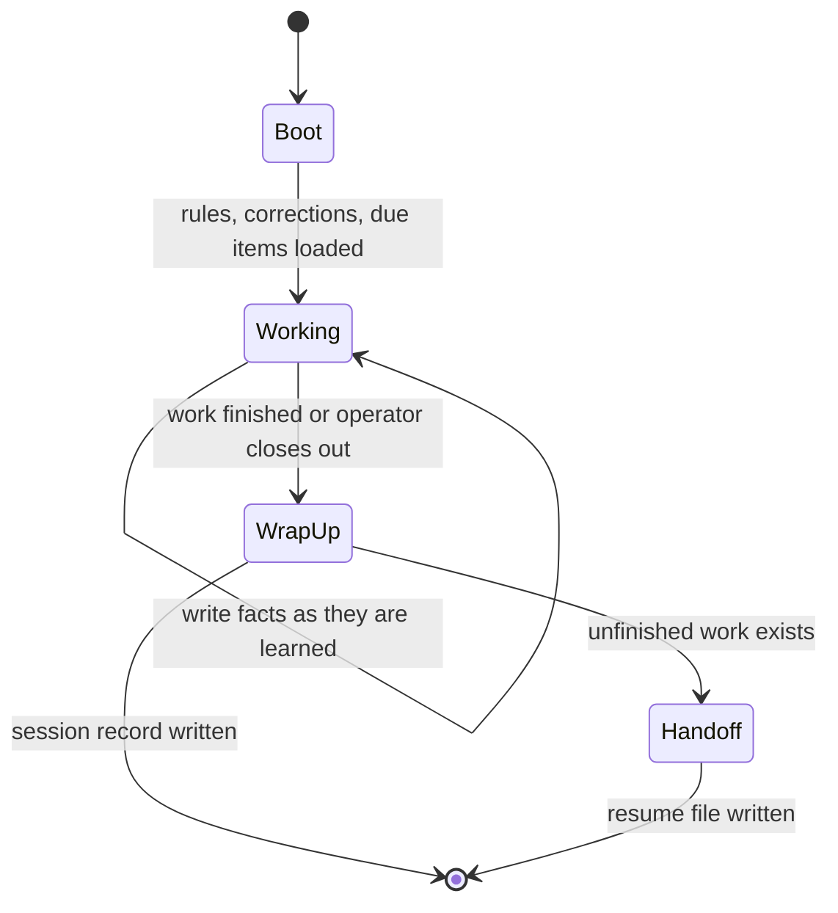

# Shared memory

An agent session has no memory of the one before it. Shared memory is the
small set of tables that fix that, plus the habit of reading them first and
writing to them last.

## What is stored

| Kind | Example (synthetic) | Lifetime |
|------|---------------------|----------|
| Standing rule | "Never send a quote without a site visit note" | Until retired |
| Correction | "Alex Sample prefers email, not calls" | Until superseded |
| Watch flag | "Supplier price list changes on the 1st" | Until cleared |
| Due item | "Call back 555-0142 about the fence estimate" | Until done |
| Session record | "Rebuilt the reminder job, 3 tests added" | Kept |

Corrections matter most. A correction is the operator saying "not like that".
Stored once and loaded every time, it turns one annoyed message into a
permanent change of behaviour.

## The session loop

- **Boot.** One call returns the pack for this agent: rules in scope, recent
  corrections, open flags, items due. It also writes a boot receipt, so "did
  the agent read the rules" has an answer. If the call fails the session says
  so in one line and carries on.
- **Working.** Facts are written when learned, not saved up for the end. A
  session that crashes should lose minutes, not hours.
- **Wrap up.** A short record of what changed, with the session id in it so
  other tools can label the entry.
- **Handoff.** If anything is unfinished, a resume file states the goal, what
  is done, what is next and what must not be touched.

## Rules for writers

1. Write facts, not transcripts. "Gate code changed" beats forty lines of chat.
2. Every row carries a source (which agent, which session) and a tenant.
3. Supersede, do not edit. The old row stays with an end date.
4. No secrets and no raw customer messages in memory. Reference the record id.

## What goes wrong

- **Boot fatigue.** A pack that grows forever stops being read. Cap it and
  rank by recency and scope.
- **Stale rules.** A rule nobody has confirmed in months should be reviewed,
  not obeyed forever. The [drift audit](rules-and-approvals.md#drift) covers this.
- **Two writers.** Parallel sessions can write conflicting facts. Last write
  wins is fine only because every write is attributed and kept.

Memory rows are tenant scoped like everything else; see
[Row level security](row-level-security.md#what-is-scoped). Next:
[Rules and approvals](rules-and-approvals.md).
